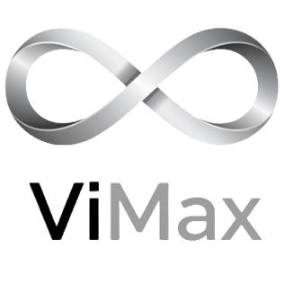
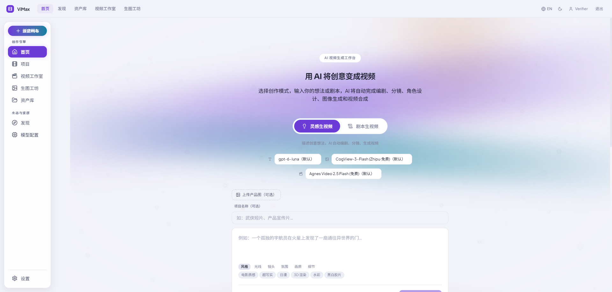
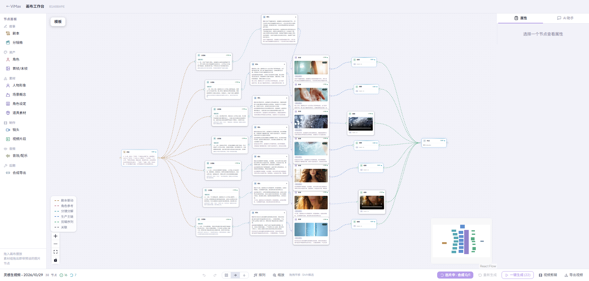
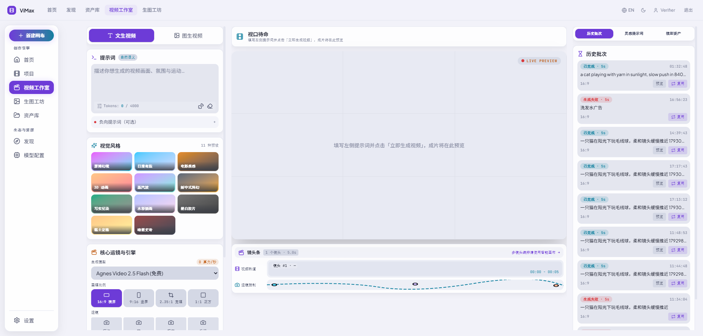
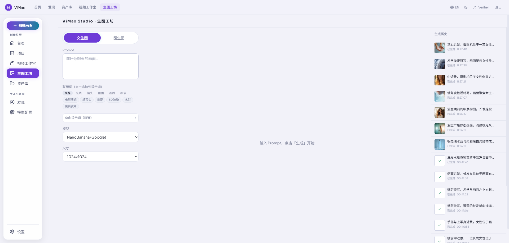
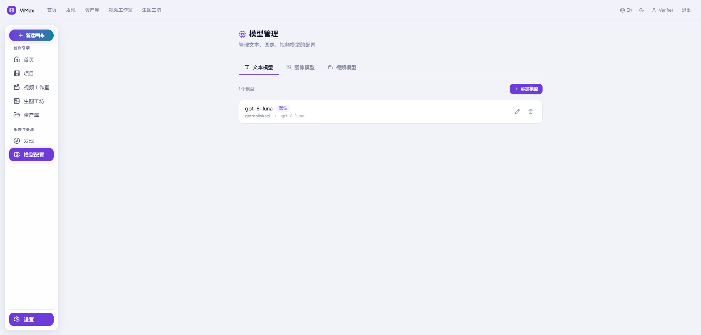

<div align="center">
  
  <h1>ViMax Studio</h1>
  <p><b>AI 视频生成工作台 —— 从一句创意到一部成片</b></p>

  
  
  
  
  
</div>

> 本项目 fork 自 [HKUDS/ViMax](https://github.com/HKUDS/ViMax)。原项目的多智能体视频生成框架（后端 Agent 能力、CLI 管线、论文与演示）说明见 **[README_VIMAX.md](./README_VIMAX.md)**。
> 本仓库在其基础上构建了面向创作者的 Web 平台 `vimax-platform`。

## ✨ 功能概览

| 模块 | 说明 |
|---|---|
| 首页 · 灵感/剧本生视频 | 输入创意或剧本，自动完成编剧、分镜、角色设计、图像生成与视频合成 |
| 画布工作台 | 基于 React Flow 的节点画布：剧本 → 分镜 → 镜头 → 图片 → 视频 → 合成，支持一键生成与重跑 |
| 视频工作室 | 文生视频 / 图生视频，视觉风格预设、运镜、画幅、镜头条与历史批次 |
| 生图工坊 | 文生图 / 图生图，联想词、负向提示词、多模型与尺寸 |
| 模型配置 | 自由接入文本、图像、视频模型（OpenAI 兼容等），设置默认模型 |
| 资产库 | Local-first：中间产物存浏览器 IndexedDB，云端仅瞬时中转 |

## 🖼️ 界面预览

**首页 —— 灵感生视频 / 剧本生视频**


**画布工作台 —— 全自动生产管线可视化**


**视频工作室**


**生图工坊**


**模型配置**


## 🏗️ 架构

```
输入(创意/剧本) → Chat Agent(决策层) → script 节点
  → pipeline-orchestrator（TS 编排）
  → 角色抽取+三视图 → 分镜 → 镜头 → 图像 → 视频 → 合成 → 下载
```

- **Web 前端** `vimax-platform/apps/web`：React + React Flow 画布、工作室页面
- **API** `vimax-platform/apps/api`：tRPC + WebSocket，决策 Agent、管线编排、BullMQ 队列、Drizzle ORM
- **Workers** `vimax-platform/workers/image`：Python worker，通过桥接层调用 ViMax 原生 Agent（编剧、分镜、角色、选图、机位树等），详见 [README_VIMAX.md](./README_VIMAX.md)
- **Contracts** `vimax-platform/packages/contracts`：前后端共享的 schema 与 job 类型

更多设计说明见 [AGENTS.md](./AGENTS.md) 与 `vimax-platform/docs/specs`。

## 🚀 快速开始

环境要求：Node ≥ 20、pnpm 9、Python 3.12（[uv](https://github.com/astral-sh/uv)）、Docker（Postgres / Redis / 对象存储）。

```bash
# 1. 基础设施
cd vimax-platform
docker compose up -d

# 2. 依赖与数据库
pnpm install
pnpm db:push

# 3. 启动 API 与 Web
pnpm dev:api
pnpm dev:web

# 4. Python worker（仓库根目录）
uv sync
```

Windows 可直接使用根目录脚本：`start-vimax-apps.ps1`、`start-vimax-web.ps1`、`start-vimax-workers.ps1`。

启动后在「模型配置」页添加文本 / 图像 / 视频模型即可开始创作。

生产部署参见 [vimax-platform/docs/deploy/ALIYUN-DEPLOY.md](./vimax-platform/docs/deploy/ALIYUN-DEPLOY.md)（`docker-compose.prod.yml`）。

## 📁 目录结构

```
.
├── vimax-platform/        # Web 平台（本项目主体）
│   ├── apps/api           # 后端 API
│   ├── apps/web           # 前端
│   ├── packages/contracts # 共享契约
│   ├── workers/image      # Python workers（ViMax Agent 桥接）
│   └── docs               # 规格、计划、部署文档
├── agents/ pipelines/ tools/   # 上游 ViMax 多智能体框架
├── main_idea2video.py / main_script2video.py  # 上游 CLI 管线
└── README_VIMAX.md        # 上游项目说明
```

## 🙏 致谢

感谢 [HKUDS/ViMax](https://github.com/HKUDS/ViMax) 提供的多智能体视频生成框架。

## 📄 License

[MIT](./LICENSE)
